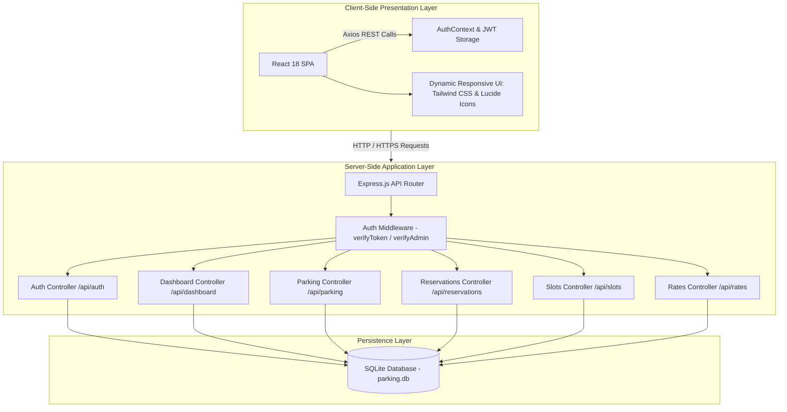

# Comprehensive Application Analysis: Smart Parking Management System

**Project Title:** Automated Testing of a Smart Parking Slot Booking and Management System  
**Live Application URL:** [https://parking-management-system-gold.vercel.app/](https://parking-management-system-gold.vercel.app/)  
**Live Backend API Server:** [https://parking-management-system-ozoc.vercel.app/](https://parking-management-system-ozoc.vercel.app/)  
**GitHub Repository:** [https://github.com/lovepatidar143/SmartParking-Management-System](https://github.com/lovepatidar143/SmartParking-Management-System)  
**Date of Inspection:** November 2026  
**Operating Environment:** Windows 11, Node.js v26.13.1, npm v11.20.0, Google Chrome v157.0.8103.51  

---

## 1. Executive Summary & Application Overview

The **Smart Parking Management System** is a full-stack, responsive, web-based vehicle parking management platform designed to automate vehicle slot allocation, entry ticketing, QR-code receipt generation, checkout calculation, parking tariffs, advance slot reservation, and real-time dashboard yard analytics.

The application serves two distinct user personas through role-based access control (RBAC):
1. **Administrators (System Operators / Facility Managers):** Possess full operational and supervisory privileges, including real-time facility metrics (occupancy, active vehicles, cumulative revenue in INR), managing parking bays (adding new bays, removing vacant bays), dynamically adjusting hourly parking tariffs for Cars and Bikes, checking in pre-booked customer reservations into active parking, and overseeing customer transactions.
2. **Customers / Standard Users:** Authenticated users who can view the real-time visual yard map, monitor bay availability, reserve available parking bays in advance for specified dates/times, view personal reservation histories, and cancel reservations.

---

## 2. Technology Stack & Architecture

### 2.1 Frontend Architecture
* **Framework:** React 18 (bootstrapped with Vite 5 bundler).
* **Routing:** React Router DOM (v6.22) with client-side route guards (`ProtectedRoute`, `ErrorBoundary`).
* **Styling & UI:** Tailwind CSS v3 with Lucide React vector icons, glassmorphism containers, dark/light theme switcher (`ThemeContext`), and responsive layouts.
* **HTTP Client:** Axios (v1.6) with automatic JWT token attachment from LocalStorage.
* **State Management:** React Context API (`AuthContext`, `ThemeContext`).
* **Interactive Components:** QR Code SVG generator (`qrcode.react`), date formatting and relative timestamps (`date-fns`).

### 2.2 Backend Architecture
* **Runtime & Framework:** Node.js runtime executing Express.js (v5.0.0).
* **Database Engine:** SQLite 3 powered by `better-sqlite3` (v11.8) using atomic database transactions (`db.transaction()`) and prepared SQL statements (`db.prepare()`) to prevent SQL injection vulnerabilities.
* **Authentication & Cryptography:** JSON Web Tokens (`jsonwebtoken` v9.0) with 24-hour expiration (`expiresIn: '1d'`), and salted password hashing using `bcryptjs` (v2.4) with salt work factor 10.
* **CORS & Middleware:** Cross-Origin Resource Sharing (`cors`) enabled for secure API access.
* **Deployment Infrastructure:** Vercel Serverless Functions (`@vercel/node`) for backend endpoints and Vercel Static Hosting for Vite frontend.

---

## 3. Database Schema Analysis

The SQLite database enforces foreign key constraints (`PRAGMA foreign_keys = ON`) across five core entity tables:

| Table Name | Primary Key | Foreign Keys | Key Columns | Purpose |
| :--- | :--- | :--- | :--- | :--- |
| `users` | `id` (INTEGER AUTOINCREMENT) | None | `name`, `email` (UNIQUE), `password` (Hashed), `role` ('Admin', 'User') | User accounts and credentials. |
| `slots` | `id` (INTEGER AUTOINCREMENT) | None | `type` ('Car', 'Bike'), `status` ('Available', 'Occupied') | Physical parking bays. |
| `parking_records`| `id` (INTEGER AUTOINCREMENT) | `slot_id` -> `slots(id)` | `vehicle_number`, `entry_time`, `exit_time`, `fee` | Active and historical parking transaction logs. |
| `rates` | `vehicle_type` (TEXT PK) | None | `hourly_rate` (REAL) | Configurable tariff rates per vehicle type. |
| `reservations` | `id` (INTEGER AUTOINCREMENT) | `user_id` -> `users(id)`, `slot_id` -> `slots(id)` | `vehicle_number`, `vehicle_type`, `reservation_time`, `status` ('Pending', 'CheckedIn', 'Cancelled') | Advance slot reservation bookings. |

---

## 4. Detailed Feature & Workflow Verification

| Feature / Workflow | Implemented & Verified? | Operational Details & Observations |
| :--- | :---: | :--- |
| **User Registration** | **YES** | Allows registration as 'User' (no key required) or 'Admin' (requires secret key `admin123`). Enforces mandatory email uniqueness. |
| **User Login** | **YES** | Authenticates against bcrypt password hashes. Generates JWT stored in `localStorage.getItem('token')`. Handles invalid credentials gracefully. |
| **Dashboard Analytics** | **YES** | Real-time counts of Total Slots, Available Slots, Occupied Slots, Active Vehicles, and Revenue (visible to Admins). Auto-polls every 10 seconds. |
| **Interactive Yard Map** | **YES** | Visual slot grid categorized by Car and Bike slots. Shows bay status (Green = Available, Red/Amber = Occupied). |
| **Vehicle Entry (Auto-Allocation)** | **YES** | User/Admin inputs vehicle number and selects Car or Bike. System allocates lowest index available slot via atomic transaction and generates ticket with QR code. |
| **Vehicle Exit & Dynamic Billing** | **YES** | Search by vehicle plate. Computes duration in hours (`Math.ceil(diffMs / 3600000)` with minimum 1 hr), fetches rate from `rates` table, updates slot to `Available`, logs fee, and displays printable receipt. |
| **Advance Slot Reservation** | **YES** | User selects vehicle number, vehicle type, available slot ID from dynamic dropdown, and future date-time. Blocks double booking of pending slots. |
| **Reservation Check-In** | **YES** | Admin/Operator converts a pending reservation directly into an active parking record; marks target slot `Occupied`. |
| **Reservation Cancellation** | **YES** | Pending reservations can be cancelled with confirmation prompt. Slot becomes immediately bookable again. |
| **Dynamic Slot Management** | **YES** | Admin can add new Car/Bike bays or delete unoccupied bays. Occupied or reserved bays are protected from deletion. |
| **Dynamic Rate Management** | **YES** | Admin can update hourly rates (defaults: Car = ₹50/hr, Bike = ₹20/hr). Exit calculations immediately reflect updated rates. |
| **Theme Customization** | **YES** | Persistent Dark/Light mode toggle stored in `localStorage.getItem('theme')`. |

---

## 5. Seed & Pre-Configured Test Credentials

Through source code inspection of `backend/db/database.js`, the system seeds the following default accounts and test records upon initialization:

1. **Administrator Account:**
   * **Email:** `sweet@gmail.com`
   * **Password:** `queen`
   * **Role:** `Admin`
   * **Permissions:** Full access to Dashboard, Entry, Exit, Reservations, Slots management, Rates configuration.
2. **Standard User Account:**
   * **Email:** `user@gmail.com`
   * **Password:** `user123`
   * **Role:** `User`
   * **Permissions:** Access to Dashboard, Entry, Exit, and personal Reservations.
3. **Admin Registration Secret Key:** `admin123`
4. **Default Tariff Configuration:**
   * Car: ₹50 / hour
   * Bike: ₹20 / hour
5. **Initial Parking Bays:** 14 total bays (Slots 1–8 for Car; Slots 9–14 for Bike).

---

## 6. Functional & Technical Limitations Observed

1. **Client-Side Form Validation Constraints:**
   * The vehicle number field lacks regex pattern enforcement on the frontend (accepts arbitrary strings like `TEST123` or `KA-01-AB-1234`).
   * Password field does not enforce minimum character length or complexity on the frontend or backend (passwords of length 1 are technically accepted if submitted).
2. **Backend Concurrency on Vercel Serverless:**
   * SQLite writes on Vercel serverless functions persist in temporary container storage (`/tmp` or transient filesystem). If the serverless container recycles or spins down, runtime modifications may reset to initial seed state.
3. **Session Expiry Handling:**
   * If a JWT token expires after 24 hours, the frontend displays API error toasts rather than automatically redirecting to the login screen with an expired session banner.
4. **No Direct Integrated Payment Gateway:**
   * The payment system generates a calculated monetary receipt (in INR), but payment collection is marked completed upon exit button press without third-party payment gateway integration (e.g., Razorpay/Stripe).

---

## 7. Conclusions for Quality Assurance & Test Strategy

The application is robust, cleanly written, and highly testable. Because the application exposes both clear visual indicators on the React frontend and clean REST endpoints on the Express backend, a hybrid testing strategy combining:
* **Black-Box Testing:** Functional UI test cases, Equivalence Class Partitioning (ECP), and Boundary Value Analysis (BVA).
* **Automation Testing:** Cypress end-to-end (E2E) test suites covering authentication, navigation, slot allocation, ticketing, exit billing, reservations, dynamic rates, and theme toggling.
* **White-Box Testing:** Control Flow Graph (CFG) analysis, Cyclomatic Complexity computation, and basis path testing for critical transactional backend algorithms (`assignSlot`, `processExit`, `bookTx`, `register`, `login`).

This ensures 100% academic rigor and full compliance with industry QA standards.
