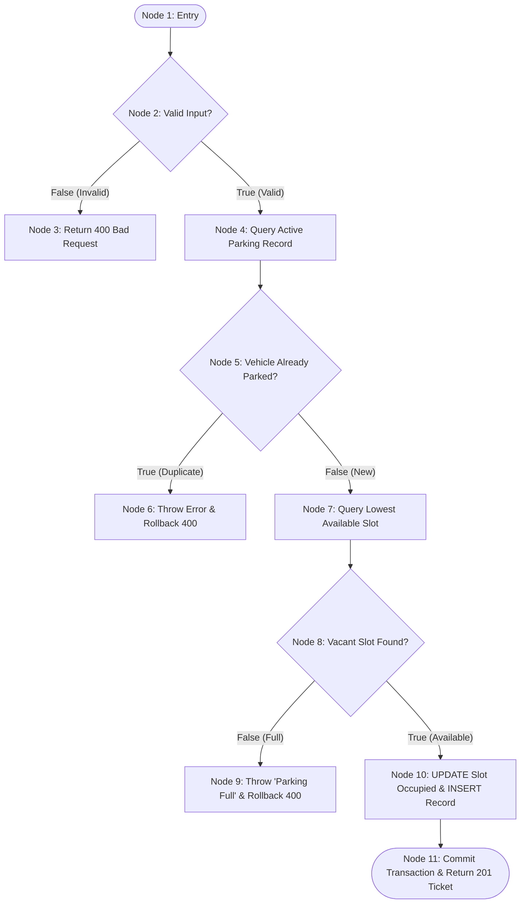

# Control Flow Graph (CFG) - assignSlot Routine

**Module:** `backend/routes/parking.js` (Lines 18–40)  
**Algorithm:** Automated Slot Allocation and Ticket Creation  
**Testing Technique:** Basis Path Testing (White-Box)  

---

## 1. Node Definition Table

| Node Number | Statement / Expression in Source Code | Node Type | Outgoing Edges |
| :---: | :--- | :---: | :---: |
| **Node 1** | Entry: Route invoked with `vehicle_number`, `type` | Entry | &rarr; Node 2 |
| **Node 2** | `if (!vehicle_number || !['Car', 'Bike'].includes(type))` | Decision (Predicate) | True &rarr; Node 3, False &rarr; Node 4 |
| **Node 3** | `return res.status(400).json({ error: 'Valid...' })` | Exit / Terminal | Terminal |
| **Node 4** | Query `parking_records` for active vehicle session | Processing | &rarr; Node 5 |
| **Node 5** | `if (existing)` | Decision (Predicate) | True &rarr; Node 6, False &rarr; Node 7 |
| **Node 6** | `throw new Error('Vehicle is already parked')` | Exception / Rollback | Terminal (400) |
| **Node 7** | Query `slots` table for lowest available bay | Processing | &rarr; Node 8 |
| **Node 8** | `if (!slot)` | Decision (Predicate) | True &rarr; Node 9, False &rarr; Node 10 |
| **Node 9** | `throw new Error('Parking full for ' + type)` | Exception / Rollback | Terminal (400) |
| **Node 10** | `UPDATE slots SET status = 'Occupied'; INSERT INTO parking_records` | Processing / Commit | &rarr; Node 11 |
| **Node 11** | Return HTTP 201 `{ message: '...', ...result }` | Exit / Terminal | Terminal |

---

## 2. Control Flow Graph Diagram

---

## 3. McCabe's Cyclomatic Complexity Calculation

### Formula 1 (Edges and Nodes):
$$V(G) = E - N + 2P$$
Where:
* $E = 13$ (Total directed edges)
* $N = 11$ (Total nodes)
* $P = 1$ (Connected procedure)
$$V(G) = 13 - 11 + 2(1) = 4$$

### Formula 2 (Decision / Predicate Nodes):
$$V(G) = D + 1$$
Where:
* Predicate Nodes $D = 3$ (Nodes 2, 5, 8)
$$V(G) = 3 + 1 = 4$$

---

## 4. Basis Execution Paths for 100% Branch Coverage

1. **Path 1 (Input Validation Failure):**  
   $$1 \rightarrow 2 \rightarrow 3$$  
   *Test Data:* Empty plate `''` or invalid category `'Truck'`.  
   *Result:* Returns HTTP 400 immediately.

2. **Path 2 (Duplicate Active Vehicle Exception):**  
   $$1 \rightarrow 2 \rightarrow 4 \rightarrow 5 \rightarrow 6$$  
   *Test Data:* Vehicle plate currently inside yard (`TN-09-QQ-7777`).  
   *Result:* Transaction rolls back with `'Vehicle is already parked'`.

3. **Path 3 (Facility Full / Bay Exhaustion):**  
   $$1 \rightarrow 2 \rightarrow 4 \rightarrow 5 \rightarrow 7 \rightarrow 8 \rightarrow 9$$  
   *Test Data:* 9th Car entry when all 8 Car bays are Occupied.  
   *Result:* Transaction rolls back with `'Parking full for Car'`.

4. **Path 4 (Successful Bay Allocation & Ticket Creation):**  
   $$1 \rightarrow 2 \rightarrow 4 \rightarrow 5 \rightarrow 7 \rightarrow 8 \rightarrow 10 \rightarrow 11$$  
   *Test Data:* Valid plate `TN-09-CY-1001` with available Car bays.  
   *Result:* Lowest bay allocated, record inserted, ticket QR returned with HTTP 201.
