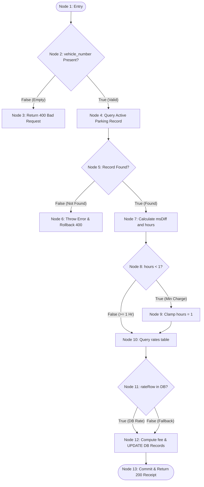

# Control Flow Graph (CFG) - processExit Routine

**Module:** `backend/routes/parking.js` (Lines 55–84)  
**Algorithm:** Vehicle Exit Checkout, Dynamic Tariff Billing, and Bay Release  
**Testing Technique:** Basis Path Testing (White-Box)  

---

## 1. Node Definition Table

| Node Number | Statement / Expression in Source Code | Node Type | Outgoing Edges |
| :---: | :--- | :---: | :---: |
| **Node 1** | Entry: Route invoked with `vehicle_number` | Entry | &rarr; Node 2 |
| **Node 2** | `if (!vehicle_number)` | Decision (Predicate) | True &rarr; Node 3, False &rarr; Node 4 |
| **Node 3** | `return res.status(400).json({ error: 'vehicle_number required' })` | Exit / Terminal | Terminal |
| **Node 4** | Query `parking_records` JOIN `slots` for active vehicle | Processing | &rarr; Node 5 |
| **Node 5** | `if (!record)` | Decision (Predicate) | True &rarr; Node 6, False &rarr; Node 7 |
| **Node 6** | `throw new Error('Vehicle not found or already exited')` | Exception / Rollback | Terminal (400) |
| **Node 7** | Compute `msDiff` and `hours = Math.ceil(msDiff / 3600000)` | Processing | &rarr; Node 8 |
| **Node 8** | `if (hours < 1)` | Decision (Predicate) | True &rarr; Node 9, False &rarr; Node 10 |
| **Node 9** | `hours = 1` (Enforce minimum 1-hour charge constraint) | Processing | &rarr; Node 10 |
| **Node 10** | Query `rates` table for vehicle category tariff | Processing | &rarr; Node 11 |
| **Node 11** | `rateRow ? rateRow.hourly_rate : default` | Decision (Ternary) | &rarr; Node 12 |
| **Node 12** | `fee = hours * rate; UPDATE records; UPDATE slots Available` | Processing / Commit | &rarr; Node 13 |
| **Node 13** | Return HTTP 200 `{ message: '...', fee, duration_hours }` | Exit / Terminal | Terminal |

---

## 2. Control Flow Graph Diagram

---

## 3. McCabe's Cyclomatic Complexity Calculation

### Formula 1 (Edges and Nodes):
$$V(G) = E - N + 2P$$
Where:
* $E = 15$ (Total directed edges)
* $N = 12$ (Total nodes)
* $P = 1$ (Connected component)
$$V(G) = 15 - 12 + 2(1) = 5$$

### Formula 2 (Decision / Predicate Nodes):
$$V(G) = D + 1$$
Where:
* Predicate Nodes $D = 4$ (Nodes 2, 5, 8, 11)
$$V(G) = 4 + 1 = 5$$

---

## 4. Basis Execution Paths for 100% Branch Coverage

1. **Path 1 (Missing Parameter):**  
   $$1 \rightarrow 2 \rightarrow 3$$  
   *Result:* Returns HTTP 400 immediately.

2. **Path 2 (Vehicle Record Not Found):**  
   $$1 \rightarrow 2 \rightarrow 4 \rightarrow 5 \rightarrow 6$$  
   *Result:* Transaction rolls back with `'Vehicle not found or already exited'`.

3. **Path 3 (Duration Under 1 Hour Clamped):**  
   $$1 \rightarrow 2 \rightarrow 4 \rightarrow 5 \rightarrow 7 \rightarrow 8 \rightarrow 9 \rightarrow 10 \rightarrow 11 \rightarrow 12 \rightarrow 13$$  
   *Result:* Duration clamped to 1 hour, rate fetched from DB, fee = $1 \times \text{rate}$, bay freed.

4. **Path 4 (Duration Equal or Exceeding 1 Hour):**  
   $$1 \rightarrow 2 \rightarrow 4 \rightarrow 5 \rightarrow 7 \rightarrow 8 \rightarrow 10 \rightarrow 11 \rightarrow 12 \rightarrow 13$$  
   *Result:* Unclamped whole duration applied, fee calculated, bay freed.

5. **Path 5 (Rate Database Fallback):**  
   $$1 \rightarrow 2 \rightarrow 4 \rightarrow 5 \rightarrow 7 \rightarrow 8 \rightarrow 10 \rightarrow 11 (\text{Fallback}) \rightarrow 12 \rightarrow 13$$  
   *Result:* Default rate applied (Car: 50, Bike: 20) when table query fails, checkout completes.
